



&nbsp;

## The work, in motion


I design and build across **AI/ML applications, full-stack software, developer tools, and applied research**. I'm studying Software Engineering at **Islamic University of Technology** and exploring how intelligent systems become dependable products.

## Selected builds

Each panel is a custom SVG, not a generated screenshot. Select the link beneath it to see the source.

<a href="https://github.com/A-Piyas-04/CareerPilot"></a>

<a href="https://github.com/A-Piyas-04/CareerPilot"><b>OPEN CAREERPILOT SOURCE →</b></a>

<a href="https://github.com/A-Piyas-04/PaperPorteHobe"></a>

<a href="https://github.com/A-Piyas-04/PaperPorteHobe"><b>OPEN SCHOLARGRID SOURCE →</b></a>

<a href="https://github.com/A-Piyas-04/woTask"></a>

<a href="https://github.com/A-Piyas-04/woTask"><b>OPEN WOTASK SOURCE →</b></a>

<a href="https://github.com/A-Piyas-04/Nexus-Ride"></a>

<a href="https://github.com/A-Piyas-04/Nexus-Ride"><b>OPEN NEXUS-RIDE SOURCE →</b></a>

<a href="https://github.com/A-Piyas-04/IUTverse"></a>

<a href="https://github.com/A-Piyas-04/IUTverse"><b>OPEN IUTVERSE SOURCE →</b></a>

<a href="https://github.com/A-Piyas-04/SATD-embedding-DP2"></a>

<a href="https://github.com/A-Piyas-04/SATD-embedding-DP2"><b>OPEN SATD EMBEDDING RESEARCH SOURCE →</b></a>

## Technical universe

**LANGUAGES / CORE**

**FRONTEND / EXPERIENCE**

**BACKEND / DATA / INFRASTRUCTURE**

**AI / ML / RESEARCH**

`LLMs` · `RAG` · `Embeddings` · `pgvector` · `Gemini` · `Qwen3` · `E5` · `XGBoost` · `UMAP` · `HDBSCAN` · `NLP`

**TOOLCHAIN / PRODUCT DEVELOPMENT**

`Tauri` · `TanStack Query` · `CodeMirror` · `Streamlit` · `Gradio` · `Prometheus` · `Grafana` · `n8n` · `GraphQL`

## Contribution signal

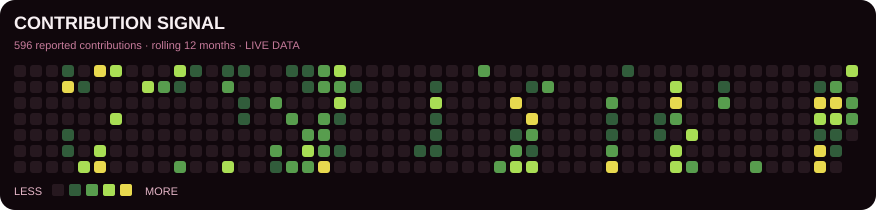

Real GitHub activity · generated by this repository's scheduled GitHub Actions workflow · green → yellow intensity

## Currently exploring

<table><tr><td width="50%"><b>AGENTIC SYSTEMS</b> Tool calling · ReAct · multi-agent workflows · memory</td><td width="50%"><b>PRODUCTION AI</b> RAG · evaluation · observability · guardrails</td></tr><tr><td><b>SOFTWARE ARCHITECTURE</b> Microservices · event-driven systems · caching</td><td><b>APPLIED RESEARCH</b> Representation learning · embeddings · software analytics</td></tr></table>


<a href="https://github.com/A-Piyas-04"><b>GITHUB</b></a> &nbsp;&nbsp;·&nbsp;&nbsp; <a href="https://github.com/A-Piyas-04?tab=repositories"><b>ALL PROJECTS</b></a>

